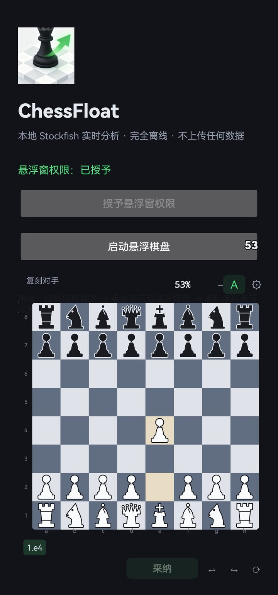

# ChessFloat Mobile

<p align="center">
  
</p>

<p align="center">
  Android 版 ChessFloat —— 系统级悬浮窗 + 本地 Stockfish 实时分析。
  <br>
  悬浮球只显示一个胜率数字，点开是完整棋盘。全程离线，不截图、不联网、不上传任何数据。
</p>

<p align="center">
  <b>桌面版（Windows / macOS / Linux）：<a href="https://github.com/Natsuki3462/chess">Natsuki3462/chess</a></b>
</p>

---

## 这是什么

桌面版 [ChessFloat](https://github.com/Natsuki3462/chess) 的 Android 移植。用肉眼把真实对局复刻到浮窗上，轮到你走时由本地 Stockfish 给出建议着法，你只需复刻对手那一步——输入量最小。

和桌面版最大的不同：**收起时是一个只显示胜率数字的透明气泡**（56dp，可拖动、自动吸附边缘），扫一眼就知道形势，需要细看再点开棋盘。手机上这个形态比半透明大浮窗合理得多。

## 特性

| 功能 | 说明 |
| --- | --- |
| 透明胜率气泡 | 只有数字，黑色描边保证任何背景下都看得清；≥60% 绿 / ≤40% 红 |
| 自绘棋盘 | 棋子是矢量路径（`Path.op` 布尔运算），不依赖字体或图片，任意缩放都清晰 |
| 点选走子 | 点起点 → 高亮合法落点 → 点落点；再点同一点取消 |
| 建议箭头 | 绿色 = 当前建议，灰色 = 上一轮遗留 |
| 胜率百分比 | 直接取 Stockfish 的 WDL 输出，期望得分口径 `胜 + 和/2`，指数平滑 |
| 历史条 | 点任意一步直接跳回，复盘用 |
| 自动采纳 | 引擎出建议后 320ms 自动走子，带版本守卫，不会抢你手动操作 |
| 自适应思考时间 | 残局/被将军/选择多时自动加时，无脑局面减时 |
| 可编辑预设 | 省电 / 均衡 / 深度 / 极限 四档，思考时间、线程、Hash 都能在设置里改，存在 SharedPreferences |
| 升变选择 | 后 / 车 / 象 / 马 四选一 |
| 长按退出 | 长按气泡 600ms 退出，棋局不保留 |

## 界面

<p align="center">
  
</p>

面板结构（顶栏 + 棋盘 + 历史条 + 底栏）：

```
┌─────────────────────────────┐
│ 轮你走 · 深度 22   53%  +0.34  A  ⚙ │
├─────────────────────────────┤
│                             │
│          8 × 8 棋盘          │
│     上一步高亮 / 将军红晕      │
│     选中高亮 / 合法落点       │
│        绿箭头 = 建议          │
│                             │
├─────────────────────────────┤
│ 1.e4  e5  2.Nf3  Nc6  ← 点任意一步跳转 │
├─────────────────────────────┤
│            [采纳]  ↩  ↪  ⟳   │
└─────────────────────────────┘
```

- `A` 自动采纳开关（开启时变绿）
- `⚙` 设置
- `↩` `↪` 撤销 / 重做
- `⟳` 换边（重新选择执白/执黑）
- 长按气泡 = 退出

## 工作原理

```
┌──────────┐  点击   ┌──────────────┐  防抖 300ms  ┌──────────────┐
│ BoardView│ ──────> │ Python 内核   │ ──────────> │ EngineWorker │
│  自绘棋盘 │ <────── │ chess.Board  │             │  单线程池     │
└──────────┘  状态    │ 唯一真源      │             └──────┬───────┘
                      └──────────────┘                    │ UCI
                             ↑                            ↓
                      ┌──────┴───────┐            ┌──────────────┐
                      │ 胜率 + 箭头   │ <────────── │  Stockfish   │
                      │ 主线程渲染    │   JSON      │  arm64 子进程 │
                      └──────────────┘             └──────────────┘
```

**1. 逻辑层原样复用，UI 层重写**

`session.py` 和桌面版几乎一字不差（只删掉了 `QObject` / `pyqtSignal` 两行）。`chess.Board` 是唯一真源，负责合法性校验、历史栈、FEN。UI 层用 Kotlin 重写，棋子路径从 `pieces.py` 的 `QPainterPath` 逐条翻译成 Android `Path`。

**2. Python 跑在 Chaquopy 里，引擎是 APK 里的一个 .so**

Android 10+ 禁止执行应用可写目录里的二进制（W^X），所以 Stockfish 必须以 `libstockfish.so` 的形式打进 `jniLibs`，安装时解压到只读的 `nativeLibraryDir` 才能 `exec`。`python-chess` 的 `popen_uci` 走 `subprocess`，路径对了就能用。

**3. 单线程池串行化所有 Python 调用**

引擎分析是阻塞的（2~6 秒），所有 Python 调用排在一个线程池里串行执行，结果以 JSON 抛回主线程。选 JSON 而不是直接传对象，是为了避开 Chaquopy 的类型转换歧义，也方便调试。

## 构建

### 前置

- JDK 17
- Android SDK Platform 35 + Build-Tools 35
- 网络（首次构建要下 AGP、Kotlin 插件、Chaquopy 运行时）

### 第 1 步：放引擎

仓库不含 76MB 的二进制。跑脚本：

```bash
./tools/fetch_stockfish.sh
```

或手动：从 [Stockfish Releases](https://github.com/official-stockfish/Stockfish/releases) 下 `stockfish-android-armv8.tar`，解包后把 `stockfish-android-armv8` 改名为 `libstockfish.so`，放到 `app/src/main/jniLibs/arm64-v8a/`。

### 第 2 步：指定 SDK 路径

```bash
cp local.properties.example local.properties
# 编辑 local.properties，把 sdk.dir 改成你自己的路径
```

### 第 3 步：编译

```bash
./gradlew assembleDebug
# 产物：app/build/outputs/apk/debug/app-debug.apk
```

> **国内网络**：`gradle-wrapper.properties` 里的 `distributionUrl` 指向官方源，可能连不上。
> 改成镜像即可：`https\://mirrors.cloud.tencent.com/gradle/gradle-8.9-bin.zip`
> Chaquopy 插件来自 `https://chaquo.com/maven`，这条没法走镜像。

### 自检（不需要设备）

Python 内核的契约可以用桌面版 Stockfish 验证：

```bash
python tools/verify_bridge.py --engine /path/to/stockfish
```

覆盖快照字段、合法着法、走子/悔棋/重做/历史跳转、四种升变、WDL 胜率换算、自适应限时、将军与将杀识别，共 38 项。

## 使用

1. 安装 APK，授予**悬浮窗权限**（系统设置里手动开）
2. 点「启动悬浮棋盘」，立刻弹执白/执黑让你选
3. 回到任意界面 → 点气泡展开棋盘
4. 循环：看到对手走子 → 在棋盘上复刻 → 等箭头 → 点「采纳」或自己走

气泡可以拖到任意位置，松手自动吸附左右边缘。长按 600ms 退出。

## 目录结构

```
ChessFloat-Android/
├─ app/src/main/
│  ├─ java/com/chessfloat/mobile/
│  │  ├─ MainActivity.kt        权限引导与启动入口
│  │  ├─ OverlayService.kt      前台服务 + 悬浮窗管理（气泡/面板两态）
│  │  ├─ BubbleView.kt          透明胜率气泡
│  │  ├─ BoardView.kt           自绘棋盘与触摸
│  │  ├─ Pieces.kt              棋子矢量路径（移植自 pieces.py）
│  │  ├─ ChessCore.kt           Python 内核的 Kotlin 封装 + 线程调度
│  │  ├─ Prefs.kt               配置持久化与预设
│  │  ├─ SettingsActivity.kt    设置页
│  │  └─ Theme.kt               配色
│  ├─ python/
│  │  ├─ bridge.py              Kotlin ↔ Python 桥接，全部 JSON
│  │  ├─ session.py             棋局状态机（桌面版原样复用）
│  │  └─ chess/                 python-chess 1.11.2（vendor）
│  ├─ jniLibs/arm64-v8a/        libstockfish.so 放这里（不入库）
│  ├─ res/                      图标与样式
│  └─ assets/                   Stockfish 的 Copying.txt / AUTHORS
└─ tools/
   ├─ fetch_stockfish.sh        下载引擎
   ├─ verify_bridge.py          Python 内核自检
   └─ make_icons.py             从一张图生成全套 mipmap
```

## 已知限制

- **只支持 arm64-v8a**（`abiFilters` 里只留了这一个）。x86 模拟器装不上。
- **没有点击穿透**。面板展开时会挡住下面那块区域，这是 Android 悬浮窗的固有行为。
- **换边只能通过 `⟳`**，会重置棋局。
- 棋盘大小固定（屏幕宽度的 92%，最大 340dp），不能双指缩放。
- 没有 PGN / FEN 导入导出，也不能保存对局。

## 合规边界（重要）

本软件**仅用于个人复盘、离线对局分析、自建环境练习**。

在在线对战平台使用引擎辅助属于违规行为，会破坏对局公平。本软件刻意不包含任何图像识别、屏幕读取、自动输入/注入能力——局面完全由用户自己手动输入。

## 许可与致谢

本项目以 **GPLv3** 发布，完整文本见 [LICENSE](LICENSE)，第三方组件与来源说明见 [NOTICE](NOTICE)。

> **关于商用**：GPLv3 允许商业使用，但任何分发（含商用）都必须以同样许可公开源代码并保留版权声明。
> 之所以不能改用「禁止商用」类许可，是因为本项目 vendor 了 GPLv3 的 python-chess，
> 在其之上附加额外限制会构成对该库的侵权。

它派生自桌面版 ChessFloat：

- **ChessFloat（桌面版）** — https://github.com/Natsuki3462/chess — GPLv3
  棋局状态机、引擎封装思路、棋子矢量路径、WDL 胜率口径与平滑算法、自适应思考时间启发式均来自该项目。

第三方组件：

| 组件 | 版本 | 许可 |
| --- | --- | --- |
| [Stockfish](https://github.com/official-stockfish/Stockfish) | 17.1 | GPLv3（二进制不入库） |
| [python-chess](https://github.com/niklasf/python-chess) | 1.11.2 | GPLv3（源码 vendor） |
| [Chaquopy](https://chaquo.com/chaquopy/) | 16.0.0 | MIT（运行时商业/开源双许可） |
| [AndroidX](https://developer.android.com/jetpack/androidx) | — | Apache-2.0 |
